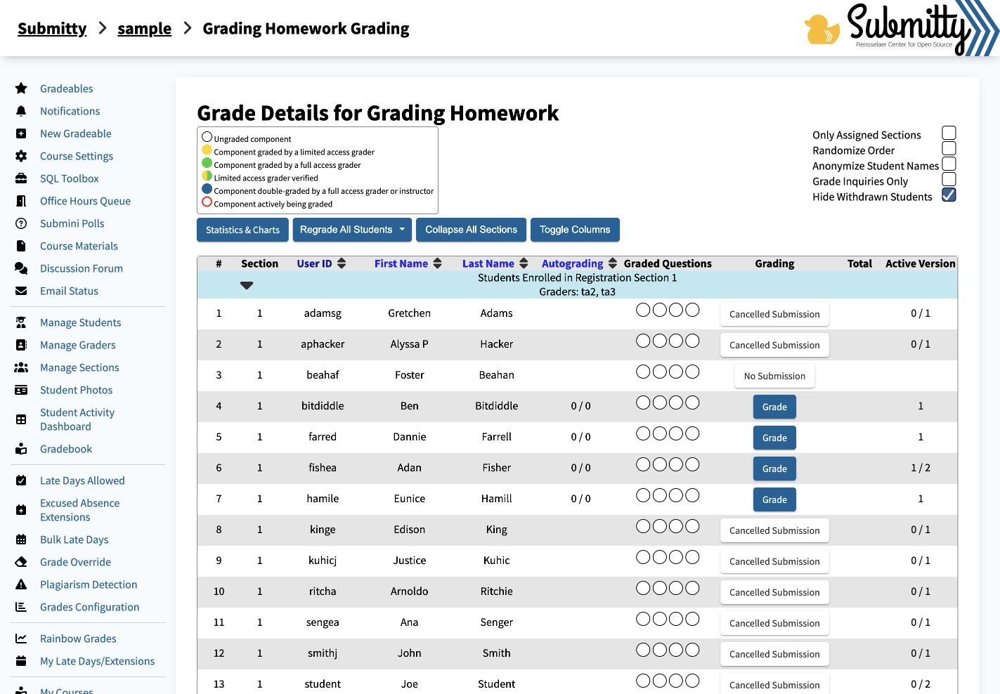
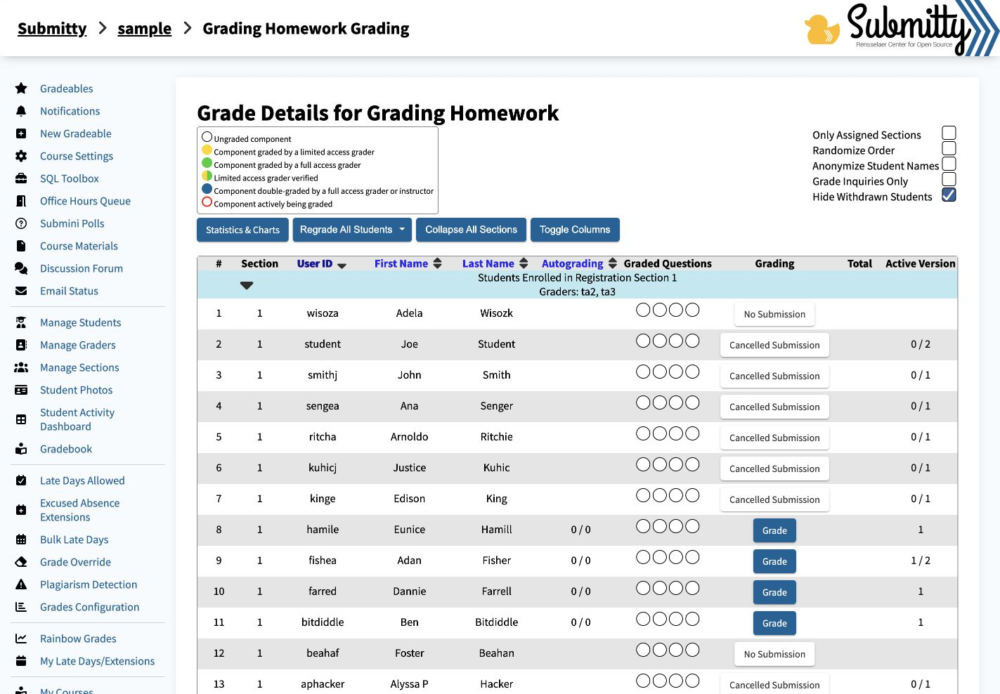

# Submitty grading-details sorting verification

Baseline: `830292b2a189a383ae1b4a6109fb691bd3b7d252` (main). Fix: `34fb452722a80ec52539bd1b9c8aff982c2f3f75`.

Change: one added import, `import '../../ts/sort-table-by-column';`, in `site/vue/src/main.ts`. Sorting logic unchanged.

Real local Apache/PHP/PostgreSQL instance in Ubuntu 22.04 ARM64 on Lima VZ (4 GiB, 4 CPUs). Sample `f26/sample/grading_homework`, instructor login. Only Assigned Sections, Randomize Order, Anonymize Student Names and Grade Inquiries Only unchecked; Hide Withdrawn Students checked. Tests cover sorting, not the full application or autograding services.

Console expression: `[typeof window.sortTableByColumn, typeof window.restoreTableSort]`.

| Browser | Version | Console output | Initial | Click 1 | Click 2 | Reload after click 2 |
|---|---|---|---|---|---|---|
| Chrome | baseline | `["undefined","undefined"]` | A | A | A | Not tested |
| Chrome | fix | `["function","function"]` | A | A | D | D |
| Brave | baseline | `["undefined","undefined"]` | A | A | A | Not tested |
| Brave | fix | `["function","function"]` | A | A | D | D |

A: `adamsg, aphacker, beahaf, bitdiddle, farred, fishea, hamile, kinge, kuhicj, ritcha, sengea, smithj, student, wisoza`

D: `wisoza, student, smithj, sengea, ritcha, kuhicj, kinge, hamile, fishea, farred, bitdiddle, beahaf, aphacker, adamsg`

Baseline load error: `TypeError: window.restoreTableSort is not a function`. Header click error: `TypeError: window.sortTableByColumn is not a function`. No such errors after the fix in either browser. Both browsers are Chromium-based. Chrome verified October 14; Brave October 15, 2026 (Asia/Kolkata).

The in-app browser independently reproduced the unchanged baseline and passing fixed clicks/reload. Its isolated automation evaluator cannot establish page-global function types; those results are excluded. The function types above were read from native DevTools in Chrome and Brave.

Both baseline and fixed production builds (`vue-tsc`, esbuild, Vite) passed. Full Cypress suite not run. Existing upstream CI workflows report `action_required`, not a passing CI result. No additional app code was changed. Local installer cleanup operations were replaced with moves to backups to honor the no-deletion constraint. Sample fixture includes only grading_homework; autograding workers were not installed.

Before and after screenshots show the in-app browser after two clicks on the User ID header:

Additional Chrome and Brave table/console captures and raw console observations are saved alongside this report.

For a recording, show the page and console, click User ID twice, and reload while the descending order is visible.

FIX CONFIRMED
